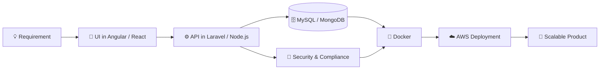

<!-- 🔁 Replace YOUR_GITHUB_USERNAME everywhere (Ctrl+F) with your real GitHub username -->

<div align="center">


<a href="https://github.com/YOUR_GITHUB_USERNAME">
  
</a>

<br/>


<br/><br/>

<a href="mailto:harshmerchant2000@gmail.com">
  
</a>
<a href="https://linkedin.com/in/harshsardiya17">
  
</a>
<a href="https://harshcodes-dev.vercel.app/">
  
</a>

</div>

<br/>

---

## 👨‍💻 &nbsp;About Me

```js
const harsh = {
  role: "Full Stack Developer",
  experience: "3+ years",
  currentlyAt: "VidyaGxP Pvt. Ltd.",
  domain: "GxP-compliant Healthcare Systems (DMS • LMS • QMS)",
  stack: {
    frontend: ["Angular", "React", "Next.js", "Ionic", "TypeScript", "Tailwind"],
    backend:  ["Laravel", "Node.js", "Express.js", "REST APIs"],
    database: ["MySQL", "MongoDB"],
    cloud:    ["AWS", "Docker"]
  },
  focus: ["Performance", "Security", "Usability", "Clean Architecture"],
  mindset: "Ship fast. Write clean. Keep learning.",
  openTo: "Impactful product engineering roles 🚀"
};
```

---

## 🚀 &nbsp;What I'm Working On

<table>
<tr>
<td width="50%" valign="top">

### 🏥 Enterprise Healthcare
Building **DMS, LMS and QMS** platforms for regulated (GxP) environments, where reliability, audit-readiness and security are non-negotiable.

</td>
<td width="50%" valign="top">

### ⚙️ Scalable Backends
Designing **REST APIs** with **Laravel** and **Node.js**, with a focus on clean structure, speed and maintainability.

</td>
</tr>
<tr>
<td width="50%" valign="top">

### 🎨 Modern Frontends
Creating responsive, intuitive interfaces with **Angular**, plus **React / Next.js** for modern web experiences.

</td>
<td width="50%" valign="top">

### ⚡ Performance & UX
Optimizing load times, queries and user flows so that apps feel fast and simple to use.

</td>
</tr>
</table>

---

## 🛠️ &nbsp;Tech Arsenal

<div align="center">

**Languages**


**Frontend**


**Backend**


**Database**


**Tools & Cloud**


</div>

---

## 🧩 &nbsp;How I Build



---

## 📊 &nbsp;GitHub Analytics

<div align="center">


<br/>


<br/><br/>


</div>

---

## 📈 &nbsp;Contribution Graph

<div align="center">
  
</div>

---

## 🐍 &nbsp;Contribution Snake

<div align="center">
  <picture>
    <source media="(prefers-color-scheme: dark)" srcset="https://raw.githubusercontent.com/YOUR_GITHUB_USERNAME/YOUR_GITHUB_USERNAME/output/github-snake-dark.svg" />
    <source media="(prefers-color-scheme: light)" srcset="https://raw.githubusercontent.com/YOUR_GITHUB_USERNAME/YOUR_GITHUB_USERNAME/output/github-snake.svg" />
    
  </picture>
</div>

---

## 🤝 &nbsp;Let's Connect

<div align="center">

I'm always open to discussing **product engineering, scalable systems and new opportunities**.

📧 **harshmerchant2000@gmail.com** &nbsp;•&nbsp; 💼 **[LinkedIn](https://linkedin.com/in/harshsardiya17)** &nbsp;•&nbsp; 🌐 **[Portfolio](https://harshcodes-dev.vercel.app)**

<br/>


</div>


