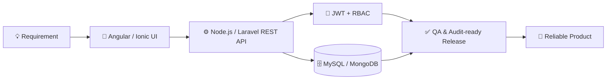

<div align="center">


<a href="https://github.com/harshmerchant">
  
</a>

<br/>


<br/><br/>

<a href="mailto:harshmerchant2000@gmail.com"></a>
<a href="https://linkedin.com/in/harshsardiya17"></a>
<a href="https://harshcodes-dev.vercel.app/"></a>

</div>

<br/>

---

## 👨‍💻 &nbsp;About Me

```ts
const harsh: Developer = {
  name: "Harsh Sardiya",
  role: "Full Stack Developer",
  experience: "4+ years",
  currentlyAt: "LiuGong India Pvt. Ltd.",
  previously: ["VidyaGxP", "Swapac Infotech"],
  specialization: ["Angular", "TypeScript", "Ionic", "Node.js", "Laravel"],
  security: ["JWT Authentication", "Role-Based Access Control (RBAC)"],
  strengths: ["Scalable REST APIs", "Responsive UI", "Performance Optimization"],
  education: "B.Tech CSE, RGPV (CGPA 7.8)",
  mindset: "Maintainable code. Reliable experiences.",
  openTo: "Impactful product engineering roles 🚀"
};
```

---

## 💼 &nbsp;Experience

| 🏢 Company | 🎯 Role | 📅 Duration | 🔑 Highlights |
|---|---|---|---|
| **LiuGong India** | Full Stack Developer | Jun 2026 – Present | IT Asset Management, Gate Pass with facial recognition, FLEX QMS |
| **VidyaGxP** | Software Developer | Sep 2024 – Apr 2026 | GxP-compliant DMS / LMS / QMS for 500+ users |
| **Swapac Infotech** | Software Developer | Sep 2022 – Jul 2024 | Hybrid Ionic apps, 15+ API integrations, 3 client deployments |

---

## 📈 &nbsp;Impact in Numbers

<div align="center">

| ⚡ **35%** | 🛡️ **99.9%** | 📬 **10,000+** | 🚀 **40%** | 📉 **50%** |
|:---:|:---:|:---:|:---:|:---:|
| faster page load | API uptime | daily API requests | faster user onboarding | shorter document review cycle |

| 👥 **500+** | 🔁 **12+** | 🔌 **15+** | 📱 **5,000+** | 🗃️ **300%** |
|:---:|:---:|:---:|:---:|:---:|
| internal users served | release cycles | REST APIs integrated | app downloads | faster data retrieval |

</div>

---

## 🚀 &nbsp;Featured Projects

<table>
<tr>
<td width="50%" valign="top">

### 🖥️ IT Asset Management System
`Angular` `TypeScript` `Node.js` `Express` `MySQL`

- Dynamic **35-field** asset specification system using **Angular Signals**
- **One-click Employee Exit Clearance** and Return-to-Stock workflow
- Executive **KPI dashboards** with reactive SVG visualizations
- **JWT + RBAC**, MySQL connection pooling, seeders, Nodemailer
- **Gate Pass module** with facial recognition for secure plant entry/exit

</td>
<td width="50%" valign="top">

### 💊 Medicef Pharma Suite (DMS · LMS · QMS)
`Laravel` `MySQL` `Angular` `Bootstrap`

- Pharma compliance for document control, training and QA
- SOP tracking with automated approvals, **50% faster** review cycles
- Real-time dashboards for training completion and audit readiness
- **100% GxP documentation compliance** via audit logging and version control

</td>
</tr>
<tr>
<td width="50%" valign="top">

### 📊 Accrue: Online Survey Platform
`Node.js` `Express` `MongoDB` `Angular Material`

- Data collection from **1,000+ users** with real-time analytics
- Validated and sanitized REST APIs
- Interactive dashboard with charts and export
- **300% faster** retrieval on large survey datasets

</td>
<td width="50%" valign="top">

### 📱 Town Dial: Rural Accessibility App
`Ionic` `Angular` `TypeScript` `MySQL`

- Built for **low-connectivity** rural users, **5,000+ downloads**
- **Offline data sync** using local storage
- Accessibility-focused UI, **35% higher engagement**
- Backend APIs for users, content and real-time notifications

</td>
</tr>
</table>

---

## 🛠️ &nbsp;Tech Arsenal

<div align="center">

**Languages**


**Frontend**


**Backend**


**Database**


**Tools & Practices**


</div>

---

## 🧩 &nbsp;How I Build



---

## 📊 &nbsp;GitHub Analytics

<div align="center">


<br/>


<br/><br/>


</div>

---

## 📈 &nbsp;Contribution Graph

<div align="center">
  
</div>

---

## 🐍 &nbsp;Contribution Snake

<div align="center">
  <picture>
    <source media="(prefers-color-scheme: dark)" srcset="https://raw.githubusercontent.com/harshmerchant/harshmerchant/output/github-snake-dark.svg" />
    <source media="(prefers-color-scheme: light)" srcset="https://raw.githubusercontent.com/harshmerchant/harshmerchant/output/github-snake.svg" />
    
  </picture>
</div>

---

## 🎓 &nbsp;Education & Certifications

- 🎓 **B.Tech, Computer Science & Engineering**: RGPV, Bhopal (2018 – 2022), CGPA 7.8
- 🏅 **Software Engineer Certificate**: HackerRank
- 🏦 **JPMorgan Chase Software Engineering Job Simulation**: Forage
- 🎨 **Front End Development Libraries**: freeCodeCamp

---

## 🤝 &nbsp;Let's Connect

<div align="center">

Open to discussing **product engineering, scalable systems and new opportunities**.

📧 **harshmerchant2000@gmail.com** &nbsp;•&nbsp; 💼 **[LinkedIn](https://linkedin.com/in/harshsardiya17)** &nbsp;•&nbsp; 🌐 **[Portfolio](https://harshcodes-dev.vercel.app)**

</div>


